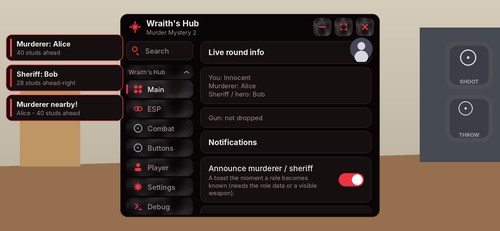

# game_dev

## Wraith's Hub - Murder Mystery 2 (`dist/wraiths_hub.min.txt`)

One-line loader (pinned to a build; the SHA is updated after every build):
```lua
loadstring(game:HttpGet("https://raw.githubusercontent.com/wraithx-knigh128/Quicksliver-s-deobf/d2e59adad420f118b93afef63a2f438097da9878/dist/wraiths_hub.min.txt"))()
```
The menu is the real **[WindUI](https://github.com/Footagesus/WindUI)** library (Footagesus, MIT licence - the full source is embedded in the script, see `mm2/vendor/`),
made small and clean: a Mac-style close dot only (no minimise / fullscreen) - our own, not WindUI's built-in one, which opens a "you will not be able to open it again" dialog
and then permanently destroys the window; ours just hides it, the same reversible way the toggle key does - no search bar, version tag or user card, five tabs (Main, ESP,
Combat, Player, Misc), a monospace
font, frosted cards that fade out to the right, WindUI's draggable open button, 10 themes (default **Dark**). The **inside stays transparent** (Settings > *Window see-through*);
the grey **water-flow texture lives only on outlines**: the window's border, WindUI's buttons and the floating buttons - a thin grey / white gradient that runs round the border
(*Button waves* High = 30 updates a second, Low = 15, Off = still). If WindUI cannot start on an executor (a blocked class, ...) the script falls back to the small built-in
**Classic** menu and says why in the Log; Settings > *Menu style* picks one for the next run. No icon pack is downloaded (a built-in set of 76 licensed [Lucide](https://lucide.dev)
icons is used, MIT, via Footagesus/Icons), and the menu
is built a few controls per frame, so loading does not freeze the game; the SHOOT / THROW buttons appear first.



(Layout preview of the **Classic fallback** menu, rendered from the test world - not a Roblox screenshot. WindUI's own 9-slice artwork cannot be rendered offline, so the WindUI
menu has no preview image; it is tested by running the real library in the fake world - see below.)

**Optional picture / video behind the menu** (Settings > *Video or picture link*, off by default): a looping video or a picture shown behind the transparent window with a dimming
slider. The link can be a direct `.mp4` / `.webm` / `.png` / `.jpg`, or a pixabay.com video page (the box is pre-filled with the lake-sunset clip you asked for: press *Load this
link now*). The file is downloaded **once** into `WraithsHub/assets/` of your executor's workspace (needs `request`/`HttpGet`, `writefile`, `getcustomasset`). Pixabay is blocked in
the build environment, so the Pixabay path is tested with a stand-in page and file, not with the real site.

**Licensed animated anime-girl background - not shipped, and why.** I searched (Pixabay, Pexels, Wikimedia Commons, Internet Archive, itch.io, OpenGameArt). The build environment can
only reach GitHub, so I could not open a licence page or download a single candidate to check it, and what the searches turned up was either AI-generated (Pixabay's anime-girl
"loop" clips mostly are - they say so), paid / "free with credit" Gumroad and itch.io packs whose licence text I could not read, or still images and sprites rather than a looping
video. I will not ship a clip I could not verify, and I will not draw or generate one. The slot is ready: find a clip whose page says it may be used and redistributed (and is not
AI-made, if that matters to you), paste its direct `.mp4` / `.webm` link (or its Pixabay page) into the box, and credit the author as the licence asks.

- **Floating buttons**: rounded squares with a **transparent inside** and a glowing grey outline that carries the flowing water. **SHOOT** (a turning, pulsing crosshair),
  **THROW** (a knife that travels round a circle) - both licensed [Lucide](https://lucide.dev) icons (MIT) - **GRAB GUN** (there is no licensed gun icon in Lucide, so this one stays
  a small hand-drawn pistol shape), SPEED / JUMP toggles (a licensed bolt / the hand-drawn chevron, brighter outline = on). Tap = fire, drag = move, size slider, lock,
  fainter without that weapon, positions saved with *Save config*. Each one is a small live readout too: a **status line** under it (the target and its distance - `Alice  42m` -,
  `RELOADING`, `NO GUN`, `MURDERER?`, `GUN  36m`), a **pip** in the corner (green = a tap will fire, grey = waiting, red = cannot), a thin **reload bar** that fills over the cooldown
  and a swell of the outline when it is ready again, a **ring** that spreads from every tap, a small recoil when it fires, and **HIT** / **MISS** after the shot (see below).
- **Auto targets by role**: Sheriff / hero -> the **murderer**, aimed ahead by your ping (innocents are never shot; if the murderer is not known yet it says so). Murderer -> the
  **closest player**. Either button does what your weapon can do (SHOOT as murderer throws, THROW as sheriff shoots). Shots use the shot you recorded once by hand; with nothing
  recorded it goes straight to really using the tool (aim + `Activate()` / the throw key - the same thing a manual click does). Combat also has a *Try known game remotes*
  toggle (**off by default**) for the remote layouts other MM2 scripts report (`Gun.KnifeLocal.CreateBeam.RemoteFunction`, `Knife.Events.KnifeThrown`, `Knife.Throw`) - these are
  unverified guesses, and `FireServer` never tells you whether the server actually did anything with a call, so a wrong guess can report "fired" / "thrown" while doing nothing;
  that's why it isn't on by default.
- **ESP**: murderer **red**, sheriff / hero **blue**, innocents green, the dropped gun **orange** (highlight, label, tracer, HUD). Event driven: a knife or gun appearing, a spawn, a
  death, new role data, a gun drop all refresh the ESP the same frame; new highlights fade in and colour changes blend.
- **Perfect aim by ping**: the aim point is where the target will be when the shot arrives = measured ping (median + EMA, lag spikes ignored) x compensation
  + the render delay of other players (default 100 ms) + trim, using engine velocity or - when the engine reports none - the position history (teleports are not velocity).
  A target in the air is led along a real **jump arc** (gravity, back down to the height it stands at) instead of a straight line. It aims at the **torso** by default (any hit
  kills, and it is the biggest part of a runner). Live "Ping 60 ms -> aim 110 ms ahead" readout.
- **The aim is held for the shot**: Roblox's own camera script rewrites the camera every frame, so a camera aim set once is gone before the weapon's script reads it. A shot now holds
  the camera and cursor on the target (a render step right after the camera script, re-leading the target every frame) until the weapon has fired, then lets go.
- **Did it hit?** `FireServer` / `Activate` never say, so the hub looks: a toast and the button show **HIT** when the target's health drops (or it goes down) within the shot's
  flight time, **MISS** otherwise - not "Shot fired" and silence. A **thrown knife's speed is measured** from the real projectile (a part that appears and flies away from you in a
  straight line) and used for the next throw; Combat > *Knife speed* sets it by hand. A gun is treated as instant unless *Bullet speed* is set.
- **Walk speed** that the game keeps resetting (a script puts `WalkSpeed` back): the hub notices the value never sticks and moves the character itself instead.
- **Moving aim reticle**: a ring with spinning ticks that glides onto the predicted point, labelled with name, distance and lead.
- gun finder (toast, HUD compass), aim assist, auto shoot / throw, silent aim, slash aura, hitbox expander (experimental), player mods.
- nothing is saved unless you press **Save config** (`wraiths_hub_config.json`).

How the game works, what is known vs. assumed, and how the hub discovers the private parts at run time: [`mm2/MM2_NOTES.md`](mm2/MM2_NOTES.md).
Source: `mm2/` (`windui_ui.lua` the WindUI adapter, `ui_lib.lua` the Classic menu + the water skins and floating buttons, `logic.lua` pure logic, `wraiths_hub.lua` the script,
`vendor/` WindUI + its licence + the three small patches + the Lucide icon subset); build with `python3 game_dev/mm2/build_mm2.py`.

## Played in a simulated Murder Mystery 2 round

`tests/mm2_sim.lua` is my own small MM2: players with full **R6 and R15 rigs** (root, head, torso / upper + lower torso, arms, legs, hands, feet - every part moves as one body), a
server that assigns a murderer and a sheriff, gives them the knife and the gun, decides every hit and drops the gun when the sheriff dies, a network with a **ping and an
interpolation delay** (other players are drawn in the past, exactly as Roblox does), bots that run in lines / circles / zig-zags / stop-and-go / bunny hops, walls, a camera script
that rewrites the camera every frame, `Tool.Enabled` as the reload, and the game's own tool scripts (they read the mouse, then call the weapon's remote). The hub is run in it
unmodified: tap a button -> the hub picks the target, aims, equips, fires -> the "game" sends the remote -> the "server" decides.

**This is a model, not the real game.** Bullet speed, knife speed, reload times, hit boxes, remote layouts and "the sheriff dies for shooting an innocent" are my assumptions (the
real numbers are not published - see `mm2/MM2_NOTES.md`). What passing proves is that the hub behaves in a world like this one, and in a family of worlds around it (hitscan or
travelling bullet, three remote layouts, 40-160 ms real render delay, engine velocity on or off). It does **not** prove anything about the real server. Sheriff, one tap, 10 starts per cell:

| hits / 10 | ping 30 | 80 | 150 | 250 | 400 |
|---|---|---|---|---|---|
| runs in a line | 10 | 10 | 10 | 10 | 10 |
| runs in a circle | 10 | 10 | 10 | 10 | 5 |
| zig-zag (flips every 0.7 s) | 10 | 10 | 10 | 10 | 0 |
| stop and go | 10 | 10 | 10 | 0 | 0 |
| bunny hops | 10 | 10 | 10 | 10 | 10 |

The zeros are not bugs to fix: nobody can aim at a player who changes direction after the shot has left. With the lead switched off the same line at 150 ms is 0/10. What the
simulation found in the hub, and what changed because of it: the one-off camera aim (0 hits in 250 once the camera script was modelled), jumping targets (linear lead missed them),
the head as a default aim part (203 vs 179 hits), the thrown knife's unknown speed, a WalkSpeed that the game resets, and a "fired" toast that said nothing about the result.

Checks (from `game_dev/`; `logic` needs `pip install lupa`, the rest need real Luau: `LUAU=/path/to/luau` or `luau` on PATH, because WindUI is Luau code):
- `python3 tests/run_mm2.py logic`                          unit tests of `mm2/logic.lua` (ping model, lead solver incl. the jump arc, velocity, targeting, shot planner ...)
- `python3 tests/run_mm2.py game`                           ~270 checks, the hub played end to end in the simulated round above (about 45 s): rigs, roles + ESP, hit rates by motion and
  ping, what it will not shoot (unknown murderer, innocent in the line, wall, dead murderer, innocent beside the murderer), knife throws + speed measurement + stab aura, gun drop and
  pickup, recorded shots and silent aim, HIT / MISS, the button status lines, walk speed (also when the game resets it) and jump power
- `python3 tests/run_mm2.py windui`                         ~230 checks of the hub on the REAL WindUI inside the fake world: the library builds the whole menu without touching a member
  the Roblox API lacks, real taps on its toggles and dropdown options and key presses change the hub's settings, outline water / transparency / compact layout, background download / dim / removal, request() vs HttpGet, staggered build,
  fallback to Classic (library fails to load / window fails half way), saved menu style, unload leaves nothing behind, and a short simulated round played on it.
- `python3 tests/run_mm2.py smoke [../dist/wraiths_hub.lua]`  ~940 checks (Classic menu, ESP colours / speed, role targets, known remotes, floating buttons) against a fake Roblox world (`tests/mm2_env.lua`): real instance tree / events / Vector3 / CFrame math,
  coroutine scheduler, executor-style `__namecall` hook, and **strict member checking from Roblox's API dump** (`tools/gen_mm2_types.sh` regenerates `tests/prop_types_mm2.lua`):
  a misspelled property, a wrong value type or a method the class does not have throws and fails the test even if the script swallowed it with `pcall`.
- `python3 tests/run_mm2.py preview [script]`               lays the UI out like Roblox does (`tests/mm2_layout.lua`: UDim sizing, UIListLayout, UIPadding, AutomaticSize, wrapped text),
  reports layout problems (text that does not fit, default "Label" text, visible borders ...) and writes JSON; `python3 tools/render_preview.py scene.json out.png` paints it.

# Animation Hub (The Strongest Battlegrounds)

Single-file executor script: `dist/tsb_hub_executor.min.txt` (built by `python3 game_dev/build_executor.py`).

**Start techs with your M1** (Main tab, on by default): arm a tech (pinned button / Assist switch / "Flowing Water -> Kyoto"), throw 1-3 M1s, and when you stop - or reach the
tech's own M1 count - the script plays the rest, casting the tech's first move itself when it does not begin with M1s. Pressing a move key between M1s cancels the
take-over, clicks the game already consumed are ignored, and touch players teach their M1 animations once with *Teach my M1*. Switch it off to go back to
"cast the first move yourself". Options: wait after your last M1 (0.15-0.8 s), most M1s to wait for (1-4); saved with *Save config*.

## Two scripts, one engine

| Script | What it is | Loader |
|---|---|---|
| **Wraith Hub v1.5** (`dist/tsb_lab.min.txt`, WindUI) | The Tech Lab alone, on the WindUI window library, built the way the tech hub it was rewritten from uses WindUI (welcome card, version tag, top bar buttons, player card, search, a card opening every tab, changelog, theme search, fonts), in white-water colours with an animated white water background. One tab per tech family, an Overview, a Settings tab with a config manager, on-screen buttons for phones. | below |
| **Animation Hub** (`dist/tsb_hub_executor.min.txt`) | The older hub (auto block, combo cards, Kyoto assist, assist / pins ...) - it has a *Tech Lab* tab generated from the same engine. | below |

```lua
-- Wraith Hub v1.5 (WindUI)
loadstring(game:HttpGet("https://raw.githubusercontent.com/wraithx-knigh128/Quicksliver-s-deobf/56a8e15004c3c0096cd282c3475b64b8366ccd0a/dist/tsb_lab.min.txt"))()
-- Animation Hub (auto block, combos, Tech Lab tab)
loadstring(game:HttpGet("https://raw.githubusercontent.com/wraithx-knigh128/Quicksliver-s-deobf/56a8e15004c3c0096cd282c3475b64b8366ccd0a/dist/tsb_hub_executor.min.txt"))()
```

## Tech Lab

The Tech Lab is a rewrite of the techs in **your own Dovi's Hub script** (the file you uploaded), not a copy of it, plus techs from community descriptions (below). That script had the same skeleton
pasted again and again (see an animation, wait, do something, hope nothing is left behind). Here the skeleton exists once (`tech_lab.lua`) and every tech is only its sequence:

```
trigger  ->  checks (master switch, enabled, cooldown, dash ready, a macro playing, another moving tech running)  ->  sequence(ctx)  ->  cleanup, whatever happened
```

What that engine gives every tech (the original had none of it):

- **Cancellable waits**: every wait stops the moment you die, respawn, switch the tech off, press **Panic**, or the master switch goes off. Nothing waits on `Tween.Completed` (a cancelled tween never completes).
- **Guaranteed cleanup**: every constraint / body mover / attachment / highlight / noclip / key hold / camera hold a tech creates is removed when it ends - also when it errors half way (a test makes a tech throw and checks nothing is left on your character).
  `AutoRotate` is always given back.
- **Dash cooldown awareness**: a tech that starts with a forward / side dash does not start while that dash is on cooldown. Switch it off with *Wait for the dash cooldown*.
- **One moving tech at a time**: two techs that move your character would fight over the root part, so a second one is skipped and the status says who is running.
- **Remote first, keys as the fallback**: dashes / M1 / moves go through the game's `Communicate` remote like in your script; *Inputs* = Auto (remote, keys when it is missing) / Remote / Keys.
- **Camera aim that survives Roblox's camera script** (held with a render step after it), body turns smoothed by a yaw filter instead of snapping, hook dash steered with a fixed line of approach (re-deriving it every frame swung round the target).
- **Learn trigger**: the animation ids are the ones from your script and TSB is patched often. If a tech stops reacting, press *Learn trigger* inside it and play the move once - the id is remembered (with *Save config*).
- Per-tech **status line**, run / abort / error counters, a log you can copy for a bug report, options clamped to their range, **nothing saved unless you press Save config**.

### Ping

Roblox gives a client its own round-trip time and nothing else, so the Tech Lab uses it where it can actually help (`tech_math.lua`, unit-tested; the engine is tested in the arena at several pings):

- **A wait counted from my own input needs no correction**: a command I send reaches the server half a ping later, and so did my earlier commands. *But* many of your animations are played by the server and sent back, so they show up a whole ping after your input,
  and a wait that starts at such an animation starts a ping late. The lab **measures that itself**: every dash it sends (or you press) and the dash animation that answers it, median of the last 9. Waits that start at one of your animations (Supa's 320 ms, Kyoto's 1.5 s,
  Uppercut Catch ...) then start earlier by exactly that gap (never cut by more than 60 %). If your client plays the animation at once the gap is about 0 and nothing changes.
- **Other players are seen late**: half a ping plus Roblox's drawing delay (default 80 ms). Aim locks (Loop Dash 2, Lethal Dash, Twisted instant), the Loop Dash / Kiba followers, Supa's landing spots and M1 Catch aim at where they *will* be (velocity x that lead).
- **Numbers tuned by hand scale with your ping**: Hook Dash's prediction (0.3 s) is the value at a 60 ms ping and grows / shrinks with the lead at yours (*The ping my default numbers were tuned at* is adjustable).
- **The dash cooldown starts when the server got the dash**: the clock dates it from the animation time minus the measured gap, plus a margin of your jitter.
- Settings: strength (0 = off, 1 = full, up to 2), a typed ping instead of the measured one, the drawing delay, the tuned-at ping, learning on / off, and an *Adjust for ping* switch per tech. The Overview shows ping, jitter, the measured gap and the lead live.
- What it can **not** do: read another player's ping, change what the server decides about a hit, or fix a connection with big jitter (it only widens the dash-cooldown margin).

### v1.5: targeting, safety, chains, buffer, hit check

All of it lives in the engine, so both scripts get it (Overview in Wraith Hub, the Tech Lab tab in the Animation Hub), and all of it is saved with *Save config*:

- **Who the techs go for**: *Nearest* (as before), *Crosshair* (nearest to the middle of the screen), *Lowest health*, or *Hook target first* (the player you picked with V, else the nearest). *Skip players who are blocking* goes for the next one instead.
- **Safe moves** (on): every tech that moves or teleports you casts a ray first and stops a little in front of a wall or ceiling, and never puts you under the floor (it finds the floor from just above the spot, so a roof does not count as the floor). Hook Dash stops at a wall in its path and says so.
- **Not while I am knocked down** (on): no tech starts while your humanoid is ragdolled / falling down / platform-standing, or the character carries a ragdoll / stun marker.
- **Chains**: *Then run* (any of M1, Backdash Cancel, Micro Dash, Shove Dash, M1 Reset, Emote Dash, Uppercut Catch) and *...after (ms)* on every tech: when it finishes, the next one starts. At most three links, so two techs cannot call each other for ever; a run that gave up half way (no target, no counter move) does not chain.
- **Input buffer** (250 ms): a key pressed while a moving tech is still running waits for it and goes right after; one pressed earlier than that is dropped, and Panic drops it too.
- **Hit check**: a tech that went for someone watches that player's health for 0.8 s afterwards; the status shows *hits x/y* and the Overview lists the hit rate of every tech that was checked. It is only a hint: the health can also drop because of someone else.

### The techs

| Tech | Group | Starts | What it does |
|---|---|---|---|
| Supa Tech | Dash techs | after your uppercut | Dash in on them: after your uppercut it dashes, snaps under them, finishes behind them and dashes again. |
| Hook Dash | Dash techs | V = pick a target, C = go (phone: double tap them, then the button) | A side dash that passes the target on its side and overshoots, then throws an M1 and holds your camera on them. Pick the target with V (the player nearest your cursor), go with C. |
| Loop Dash | Dash techs | after your uppercut | A loop round the target while dashing, then you settle above them. |
| Loop Dash 2 | Dash techs | after your uppercut | Better loop dash (also for oreo tech): jump, dash, then lock your body on the target. Pauses while someone is blocking. |
| Lethal Dash | Dash techs | after Lethal Whirlwind Stream | Lethal water into a dash: jump, dash and lock on to the target once the move is over. |
| Kiba / Kitty Tech | Dash techs | after your uppercut | After the uppercut: dash and hang on the target head-down (Kiba), or circle them (Kitty Tech, idea by ItzSoph). |
| Twisted (4 M1 into a dash) | Dash techs | after the M1 string's last move | A small step back, then a dash at them. 'Instant' also turns you to face them during the dash. |
| Auto Kyoto | Combos | after Flowing Water | Flowing water into lethal: casts Lethal Whirlwind Stream for you, then hops sideways. |
| Lethal Dunk | Combos | after Lethal Whirlwind Stream | Lifts you above them a moment after Lethal Whirlwind Stream. |
| Auto Hunter Surf | Combos | when the surf starts | Carries you forward on the surf. |
| Uppercut Catch | Combos | after your uppercut | After the uppercut: forward dash and an M1 at the right moment - or, if he falls close to you, just walk into him (hold W) and M1. |
| Uppercut Grasp | Combos | after your uppercut | 3 M1s, jump, mini uppercut - then Hunter's Grasp is cast for you. |
| Lethal Grasp | Combos | after Lethal Whirlwind Stream | Right after Lethal Whirlwind Stream: Hunter's Grasp. |
| Flowing Grasp | Combos | after Flowing Water | After Flowing Water ends, Hunter's Grasp is cast (spammed a few times). Turn on shift lock yourself. |
| Auto Counter | Defence | when somebody dashes / M1s at you | Casts your counter (Prey's Peril / Split Second Counter) when a close player starts a dash or an M1 at you. |
| Dash Flip | Helpers | after your forward dash | Pitches you up a little while you dash (the tech helper's flip). |
| M1 Catch | Helpers | while somebody is in front of you | Holds M1 for you when somebody steps into the box in front of you. |
| Mouse Dash | Helpers | after your forward dash | Turns you toward your cursor for a moment after a forward dash, so the dash goes where you point. |
| Side M1 (hitbox abuse) | Helpers | when you click | Swings your body to the side for a moment when you M1, then back. PC only. |
| No End Lag | Helpers | Q right after a side dash | Press Q within a moment of a side dash and the forward dash goes out at once. |
| M1 Slide | Helpers | after a side dash | Throws an M1 for you right after every side dash. |
| True Down Slam | Helpers | when your down slam starts | Lifts you when your down slam starts with somebody close, so it lands as the aerial one. |
| Fast Dash | Helpers | when you side dash | Throws you along the side dash with a burst and cuts the dash animation short. Not compatible with most other techs (only one moving tech runs at a time). |
| DashClip | Helpers | when you dash | Noclip for a moment while you dash (your own character only). |
| M1 Reset | Actions | key / button | Side step, turn and dash - resets your M1 chain. |
| Emote Dash | Actions | key / button | Turns and throws you sideways in an arc. |
| Backdash Cancel | Actions | key (B) / button | Back dash, then a move right away: the move cancels the back dash. 'Aerial' jumps first so the back dash carries further. The window is short - tune the delay. |
| Micro Dash | Actions | key (X) / button | Side dash, then a move at once (an M1 does not cancel the dash, a move does). |
| Shove Dash | Actions | key (Z) / button | Shove, an instant M1, a step back and a forward dash (the M1 after the shove should be your 1st-3rd). |
| Counter ESP | Awareness | when a player uses a counter | Highlights a player for a few seconds when he starts a counter move, so you know not to hit him. |
| Death Counter ESP | Awareness | when a player gets a Death Counter | Highlights a player while a Death Counter is on him (it is a child called 'Death Counter' in his character). |
| Unblockable Warning | Awareness | when a player winds up the unblockable down slam | A red arrow above a player while he telegraphs the unblockable down slam: dodge it, do not block it. |
| Block ESP | Awareness | while a player blocks | Highlights a player for as long as he is blocking. |

Auto block stays the Animation Hub's own (Auto Tech tab): it learns timing and predicts rushes, which your script's version did not. Credits: Kitty Tech idea by ItzSoph (credited in your script too).

**Where the newer techs come from.** Fast Dash, DashClip, Counter ESP, Death Counter ESP and the unblockable-down-slam arrow (your "Block Indicator") are in your script. Backdash Cancel (+ aerial), Micro Dash, Shove Dash, Uppercut Catch,
Uppercut Grasp, Lethal Grasp and Flowing Grasp come from community descriptions of TSB techs that I found by searching: the
[techniques page of the TSB fan wiki](https://the-strongest-battlegrounds-rblx.fandom.com/wiki/Techniques), [Item Level Gaming's all-character tech guide](https://itemlevel.net/the-strongest-battlegrounds-all-character-techs-guide/) and
[bloxodes' technique list](https://bloxodes.com/wiki/the-strongest-battlegrounds/techniques). **I could not open those pages from my session** (their hosts are not reachable from it), so I only had the search summaries: the sequences are the ones those
summaries describe (e.g. "backdash, then immediately use a move", "side dash, then immediately a move - an M1 does not cancel it", "after an uppercut: forward dash and click M1 at the right moment, or hold W if he falls close"), and
the **default delays are my guesses** - the real windows are short and patch-dependent, so tune them in the tech's tab. The community sources disagree on details and are partly promotional; none of it is verified.

**Not ported from your script, on purpose:** No Stun, No Slow, No Fatigue, No Dash Cooldown, Speed / Jump boosts, Respawn at Death, the avatar changer, Counter Toxic, shaders, map teleports and the player-ESP boxes. They are not techs: several tamper with game state instead of
automating inputs (and I cannot test what they do to the server), the rest are unrelated to the techs. Say so if you want any of them.

**Honest status:** none of this has been run in Strongest Battlegrounds. The animation ids, move names and the `Communicate` remote layout come from reading your script, and TSB changes often.
What *is* tested: the pure maths (`tech_math.lua`, unit tests), the option sanitising, the whole engine in a simulated arena (`tests/tsb_sim.lua` - characters in `Workspace.Live`, a dummy, the remote, animation events, velocity constraints,
a network with a ping and server-played animations, other players drawn in the past, strict Roblox member checking from the API dump): every tech's sequence, cancel / death / respawn / panic, cleanup, cooldowns, the ping model, config round trips,
and mutation checks (`tools/mutate_tsb.py`: 52 deliberately broken copies of the engine, 50 make the tests fail and 2 are equivalent - explained in the tool; `tools/mutate_tsb_hub.py`: 28 broken copies of the WindUI hub, 14 of them aimed at the v1.5 additions). The WindUI hub is also played on the **real WindUI library** inside the same arena
(`tests/tsb_hub_tests.lua`): real clicks on its toggles, sliders, key binds, top bar buttons and on-screen buttons drive the techs, the white water layers exist, move, stand still while the window is closed and follow the theme, the welcome card / changelog / player card / search bar / tab cards are there,
nothing is written until Save config, a saved config comes back (v1.5 settings included), unloading removes everything (every listener still connected afterwards is traced to the line that made it: none of ours is left), and the small built-in menu takes over when WindUI cannot start.
A passing test means "the code does what it says in a world like the one your script describes"; it cannot show how the window *looks* (no renderer for WindUI's images) or that an executor allows what WindUI needs.

Checks for the Tech Lab (from `game_dev/`): `python3 tests/run_tests.py` (maths / data / options), `LUAU=/path/to/luau python3 tests/run_tsb.py lab` (the engine in the arena), `... run_tsb.py hub` (the WindUI hub on the real WindUI),
`sh tools/gen_tsb_types.sh` (regenerates the strict API tables after using new Roblox members), `python3 tools/mutate_tsb.py` / `tools/mutate_tsb_hub.py` (mutation checks), `python3 tests/check_docs.py` (every tech is in this README).
Build: `python3 game_dev/tsb/build_tsb_lab.py` (WindUI hub) and `python3 game_dev/build_executor.py` (Animation Hub).

### Wraith Hub v1.5 (WindUI)

- **The WindUI structure of the hub it was rewritten from**, rebuilt with this hub's own text and code: a **welcome card** when it starts (a white-to-silver title, *What is new* / *Start*; switch it off in Settings), a **v1.5 tag** next to the title,
  **icon buttons in the top bar** (Panic, Water on / off, Changelog), **your player card** at the bottom of the side bar, the **search bar**, a **card opening every tab** (it lists that tab's techs and when each one starts), a **changelog dialog**,
  a **theme list with search**, a **font choice** (Default, Gotham, Code, Fredoka, Arcade) and the menu key.
- **White water colours**: the default theme *Wraith White* (white switches / sliders / outline on a dark slate window, see-through cards), *Wraith Pearl* (a light one), plus Frost / Ember / Mint and WindUI's own themes.
- **Animated white water background**, made in the script (nothing is downloaded, so nothing can fail to load): four full-size layers, each a white fill whose `UIGradient` only lets thin bright bands through - the crests of a sharpened sine
  (`(0.5 + 0.5 sin x) ^ k`), at most 20 keypoints as Roblox allows. Every layer drifts (`Offset`) and sways (`Rotation`) at its own speed, so the bands cross and part like light on moving water; the fourth, fast and sharp layer gives the glints.
  It only animates while the window is open, at most 30 times a second, and only touches two properties per layer per frame (no new instances, no tweens piling up). Settings: on / off (also the top bar button), brightness, wave speed;
  on the light theme it turns slate (white on white would not show).
- **Your own picture or video under the water** (optional): a direct .png / .jpg / .webm link or `rbxassetid://`, with a darkening slider. Same mechanism as WindUI's own `Background` option (see the research below).
- **Layout**: *Overview* (master switch, Panic, input mode, **targeting and safety** - who the techs go for, skip blockers, safe moves, the knocked-down guard, the input buffer - and a live panel with dash cooldowns, ping and **hit rates**),
  then one tab per family - Supa, Hook Dash, Loop Dash, Kiba / Kitty, Kyoto Combo, Lethal Dash, Twisted, M1 Reset, Cancels, Auto Counter, Tech Helper, Awareness - and *Settings* (menu, background, ping model, on-screen buttons, config manager, changelog, log, unload).
  Every tech has its switch, a status line, all its options (sliders, switches, dropdowns, any-key key binds, text boxes; *Then run* / *...after* for chains), *Learn trigger* and *Reset*. The tabs are generated from the tech definitions, so a new tech needs no UI code.
- **On-screen buttons for phones**: PANIC (on by default), HOOK, M1 RESET, EMOTE DASH, BACKDASH, MICRO and SHOVE (switched on inside each tech). Draggable, lockable, with a cooldown bar and the tech's status. Hook Dash on a phone: double tap a player to select him, then tap HOOK.
- **Config manager**: named configs in the `TSBLab` folder (kept from the earlier versions so old configs still load; names are cleaned so they cannot leave the folder), *Save / Load / Delete*, a list of what is there, and *Auto load* - decided when you press Save, written to `TSBLab/index.json`.
  A config also holds the v1.5 settings (water, background, font, welcome card, targeting). Nothing is written before you press Save. Invalid values in a file fall back to the defaults or are clamped; a broken file never stops the hub.
- **Fallback**: if WindUI cannot start (an executor that blocks its file / web calls) the small built-in menu opens with the same tabs and the techs work the same (no water there: it is part of the WindUI window).
- WindUI is the MIT-licensed [Footagesus/WindUI](https://github.com/Footagesus/WindUI) (v1.6.65, byte-identical to the current 1.6.66 release file), embedded unchanged apart from three small patches (no icon downloads); its icons are the built-in Lucide subset (MIT).

#### Animated WindUI backgrounds: what the research found

- **WindUI itself** takes `Background = "rbxassetid://..."` / an http image link / `"video:<link>"` in `CreateWindow`, plus `BackgroundImageTransparency`, and `Window:SetBackgroundImage`. A `video:` link is downloaded, saved with `writefile` and played through
  `getcustomasset` in a `VideoFrame`; WindUI's own source warns that video backgrounds "may not work". That is the only "animated background" WindUI has: it does not animate anything by itself.
- **Mods and look-alikes**: WindUI-Mod's README shows the same `video:` .webm background (with `BackgroundImageTransparency`) and nothing animated beyond it; a Material-Design-3 Roblox UI added video backgrounds the same way and refuses GIFs
  with a clear message (Roblox cannot play a GIF; only its first frame would show).
- **VideoFrame limits**: Roblox caps video at 1280x720, uploads take only .mp4 / .mov, and a local file has to go through `getcustomasset` (not every executor has it, and the .webm has to be downloaded each session). Free stock wave clips exist (Mixkit, Pixabay), but every one is a download that can fail.
- **The DevForum way** to animate a UI background without media is a `UIGradient` whose `Offset` / `Rotation` are moved every frame - cheap, works everywhere, nothing to load. The white water here is that idea pushed further: several layers, crests made by a
  sharpened sine, each layer at its own speed and angle, only while the window is open.
- So v1.5 uses the self-made water by default, and keeps WindUI's picture / video mechanism as an *option* for anyone who wants a clip under it.
- Sources: [Footagesus/WindUI](https://github.com/Footagesus/WindUI) and its [releases](https://github.com/Footagesus/WindUI/releases); [WindUI docs on Context7](https://context7.com/footagesus/windui); [SLK-GAMING-MOD/WindUI-Mod](https://github.com/SLK-GAMING-MOD/WindUI-Mod);
  [Material-Design-3-Roblox-lua-ui PR #12](https://github.com/engnyg/Material-Design-3-Roblox-lua-ui/pull/12); DevForum: [VideoFrames are capped at 1280x720](https://devforum.roblox.com/t/roblox-videoframes-are-capped-at-1280x720/3901780),
  [local video files for VideoFrames](https://devforum.roblox.com/t/using-local-video-files-for-videoframes/808249), [4 UIGradient animations](https://devforum.roblox.com/t/4-uigradient-animations-including-rainbow/557922),
  [UIGradient animation](https://devforum.roblox.com/t/uigradient-animation/2637300); [Roblox wiki: Video](https://roblox.fandom.com/wiki/Video); stock clips: [Mixkit waves](https://mixkit.co/free-stock-video/waves/), [Pixabay waves](https://pixabay.com/videos/search/waves/).
  Not reachable from where this was built (so not read): the WindUI docs site (footagesus-windui.mintlify.app, footagesus.github.io), create.roblox.com, and the Mixkit / Pixabay pages themselves.

Nothing is saved automatically (that includes your own menu picture: Save config keeps it). The Config tab has Save config / Reload / Delete; the only file is `animation_hub_config.json`, loaded when
the hub starts (an old `animation_hub_settings.json` from earlier versions is ignored).

Checks (from `game_dev/`):
- `python3 tests/run_tests.py`           logic tests (needs `pip install lupa`)
- `python3 tests/run_smoke.py [file]`    UI smoke test on Lua 5.x via lupa
- `LUAU=/path/to/luau python3 tests/run_smoke_luau.py [file]`   same smoke test on real Luau (what Roblox runs)
- `python3 tests/check_palette.py`        the menu themes must stay bright (window luminance) and readable (WCAG contrast)
- `tools/validate_api.py`                every Roblox property/enum/service used vs Roblox's real API dump
- `tools/gen_prop_types.py`              regenerates `tests/prop_types.lua` (real property VALUE types); the smoke test rejects wrong-typed assignments and tweens like Roblox does

Also here: `UI_GUIDE.md` (how to build this kind of menu, where), `examples/mini_ui.lua` (a small complete menu for Roblox Studio),
`tools/validate_api.py` (checks Roblox property / enum / event names against the real API list).
