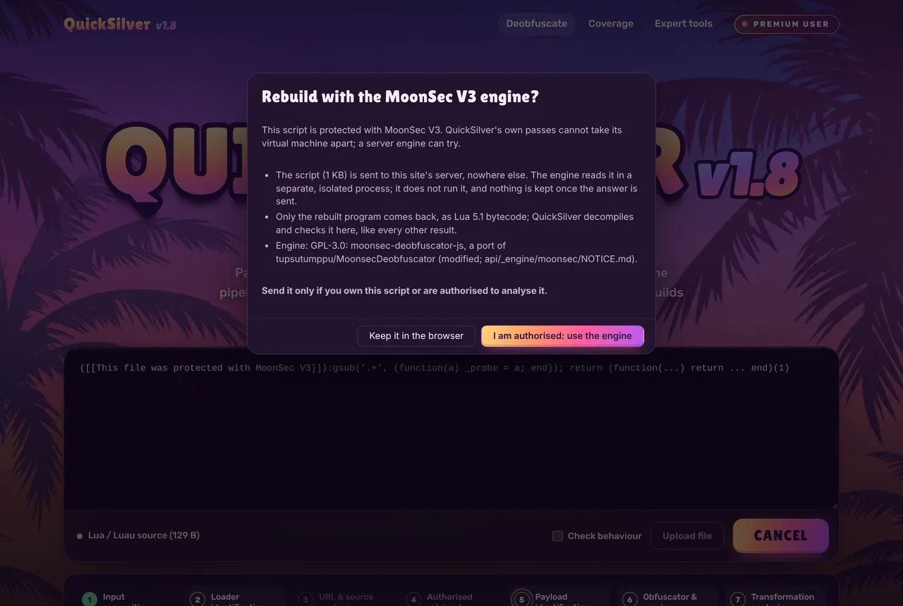

# Prompt XXIX — the deobfuscator archive, research, and two server engines behind the one Deobfuscate

Measured 2026-11-24 to 2026-11-26 in this repository. Third-party code was never run on the host: every run of a tool from the archive
or from GitHub went through `tools/isolate/run.sh` (no network namespace, a private mount namespace with empty `/home`, `/root` and
`/tmp`, the user `nobody`, CPU, memory, file-size and process limits, a wall-clock kill). Third-party samples stay in the git-ignored
`local/`. The scripts named in each section are in `tools/engines/xxix/` and their per-file results in `data/research/xxix-engines.json`.

## 1. What changed for the person using the site

The single **Deobfuscate** button is unchanged. Two formats now have a **server engine** behind it, chosen by detection, never by the
person (`src/pipeline/engines.js`):

| Format | Engine | When it is asked | When its result is used |
|---|---|---|---|
| MoonSec V3 | vendored moonsec-deobfuscator-js (GPL-3.0), rebuilds the VM program as Lua 5.1 bytecode; QuickSilver decompiles it | always, after the person confirms the script may be sent | whenever it decompiles; it is classified like every other result (usually "syntax-valid but behaviourally unverified") |
| Prometheus Vmify builds (Weak / Medium / Strong / Vmify) | vendored Prometheus Deobfuscator (MIT), lifts the VM to Lua | only when QuickSilver's own result still carries Prometheus protection, only with *Check behaviour* on, after the person confirms | only when the behaviour comparison with the script itself is identical and reaches at least half of the program's lines |

Before anything leaves the browser, a dialog says what is sent where, that the engine does not run the script, that nothing is kept,
the engine's licence, and asks the person to confirm they own the script or are authorised to analyse it (`src/app/engine-ui.js`).

Declining, an engine that is not deployed, a licence refusal, a failure, a timeout or a rejected result all fall back to QuickSilver's
own passes, and the result's notes say which and why. Nothing is reported as an engine's result unless the engine produced it.

## 2. Phase I — the six projects in the archive

Read in full where used, otherwise read for structure, entry points, every path to the host, and claims. Line counts are code lines
(`.js`, `.py`, `.lua`, `.luau`).

| Project | What it is | Licence | Size | Findings |
|---|---|---|---|---|
| MoonSec-Deobfuscator | moonsec-deobfuscator-js: JavaScript port of tupsutumppu/MoonsecDeobfuscator (C#). MoonSec V3 → Lua 5.1 bytecode, then shells out to `luadec` / `unluac` | GPL-3.0 declared in package.json, no licence file (upstream's is GPL-3.0) | 6,124 | **Remote code execution**: its key-expression evaluator opened every fengari library, so a script's key expression could call `os.execute` (proved inside isolation: wrote `uid=65534(nobody)`). Upstream evaluates with `openLibs: false`; the port regressed. Strings decoded as UTF-8 (lossy). Ships decompiler binaries. **Integrated, modified** (§5). |
| Prometheus-Deobfuscator-Fixed | LeakD's Prometheus deobfuscator: parser, step reversers, Vmify lifter, own small Lua interpreter | MIT | 16,707 | No host access in its code path (its interpreter has no `os` / `io`). One undefined name (`BLOCK_TERMINATORS`) crashed 55 of 131 runs. Wrong on 6 of 53 VM builds (§3). **Integrated behind a behaviour gate** (§5). |
| LuaObfuscator-Deobfuscator | deobfuscator for luaobfuscator.com output | **none** | 9,321 | Claims success on output that still holds the VM (§3). No licence: cannot be integrated. |
| CaoMod-Luraph-Deobfuscator | Luraph v14/v15 deobfuscator with a Luau harness | MIT (caomod2077); package.json says ISC | 110,360 | Same lineage as `api/_engine/luraph` (67–94% line similarity per file). `fetch.js` sends executor user agents ("Roblox/WinInet", "Synapse", "Krnl"); the harness can fetch URLs at run time. Not integrated (§8). |
| Luraph-v15.1-Deobfuscator | Luraph v15 / v15.1 variant of the same codebase | MIT (caomod2077) | 52,250 | Its runtime emulates executor environments (`envlog.luau`: "Synapse-style surface … is an executor check") to get past Luraph's environment checks. Not integrated: QuickSilver does not reproduce Luraph v15 anti-tamper handling. |
| Luraph-v15.2-Deobfuscator | v15.2 work-in-progress of the same codebase | MIT (caomod2077) | 26,846 | Same as above; the research repository it mirrors is assessed in §4. Not integrated. |

## 3. Phase II — what each one actually does (capability matrix)

Measured, not claimed. "Right" means QuickSilver's sandbox ran the output next to the reference and every event, the output and the
ending were the same; "left" means QuickSilver's detection still finds the protection in the output.

### MoonSec V3 (public collection `local/terrorlua/MoonSec/V3`, 792 files; scripts `ms-one.sh`, `ms-eval.mjs`, `ms-verify2.mjs`)

| | moonsec-deobfuscator-js, as supplied | after QuickSilver's changes |
|---|---|---|
| Rebuilt to bytecode | 786 / 792 (4 crashes, 2 killed at the memory limit) | 786 / 792 |
| Decompiles to Lua that parses | 786 (677 every function, 109 some functions left undecompiled) | 786 (677 / 109) |
| String constants | lossy UTF-8; the first byte of every high-bit-led constant dropped | byte-exact; rule chosen by the kind of build (below) |
| Behaviour, 120 sampled files | 26 identical, 92 different, 2 inconclusive (no account of MoonSec's runtime) | keyless builds (73): **31 identical**, 40 different, 2 inconclusive; keyed builds (47): no usable reference |
| MoonSec V2 (883 files) | reads none | not sent to it |
| QuickSilver alone | — | detects MoonSec V3; its own passes do not take the VM apart |

The string rule. Keyless builds (one key expression) copy constants verbatim (`for i = 1 + 0, #s`): 132 of 16,639 constants start
above 0x7F and are UTF-8 text the supplied rule cut short. Keyed builds (two key expressions): 19,451 of 20,721 constants carry a
marker byte; with it dropped and the key added, 19,308 of 19,324 read as text (the other 16 are emoji stored as UTF-16 surrogate
pairs, as their source had them); verbatim, none does. Upstream (C#) applies the marker rule to every build, so it has the keyless
defect too. The keyed rule rests on text evidence: no keyed original runs far enough in the sandbox to compare behaviour.

The 40 keyless differences, read one by one (`ms-diff2.mjs`): 29 are the same error at the same point whose message names a
different variable (the VM keeps no names; `verify` now says so in a note and keeps the verdict "different"), 5 originals printed
MoonSec's own "A picture taken from your webcam" message instead of running, 1 wrote MoonSec's own runtime globals, 3 are equal
values written differently in the trace (a folded concatenation, a stand-in object's name), and **2 are genuine differences in the
order of calls** (`c0263d72…`, `3fed8cb5…`), not yet explained (KNOWN-ISSUES #106).

Of the 786 rebuilt programs, 354 (45%) call functions only exploit executors provide and 549 (70%) download and run more code
(`ms-kinds.mjs`).

### Prometheus (QuickSilver's own 131 fixtures with originals; scripts `pm-batch.sh`, `pm-force.sh`, `up-batch.sh`, `tool-eval.mjs`)

Each tool's output, run next to the original in QuickSilver's sandbox:

| | all 131: right & clean / right, protection left / wrong / failed | 53 Medium, Strong and Vmify builds: right & clean / wrong / failed |
|---|---|---|
| QuickSilver's own passes | 57 / 68 / 6 / 0 | 8 / 5 / 0 (40 with the VM left, reported "partial") |
| Prometheus-Deobfuscator-Fixed (as supplied, `--force`) | 53 / 5 / 18 / 55 | 26 / 11 / 16 |
| unprom (yennylol, MIT; Python) | 49 / 13 / 66 / 0 | 0 / 44 / 0 |

Scored against the original. Five of the engine's "wrong" VM results, and all 6 of QuickSilver's, are one program (`s03_encoded_strings`) in five builds: the fixtures' manifests record that these
protected builds themselves diverge from the original on real Lua 5.1, LuaJIT and 5.4 (Prometheus drops the parentheses of
`print((s:gsub(…)))`; the sandbox confirms the same of the two `prometheus-seeds` builds of it, whose manifest records no behaviour). The engine reproduces the protected script faithfully there; against the script, it is right on 31 VM builds
and wrong on 6. A behaviour comparison **with the script itself** (`gate.mjs`) accepts all 31 and none of the 6 — the basis of the
gate. unprom's own VM tests use hand-made fixtures that "mirror Vmify codegen, not produced by Prometheus itself"; on real Prometheus
output it lifts no VM build correctly.

### The integrated pipeline on the same 131 fixtures (script `integ.mjs`, scoring `baseline.mjs`)

The one Deobfuscate exactly as the site runs it (`deobfuscate()` with the real detection, recovery, server engines run through
`api/_lib/isolate.js`, the gate, the fallback, the behaviour check on), against QuickSilver's own passes alone. The reference is the
original, or the protected script where the protected build itself behaves differently (the manifest's record of real Lua where it
has one, the sandbox otherwise).

| | QuickSilver alone | QuickSilver + gated engine |
|---|---|---|
| all 131: behaves like the reference, nothing left | 59 | **94** |
| all 131: behaves like the reference, protection left | 72 | 37 |
| all 131: behaves differently from the reference | 0 | 0 |
| 68 builds that use Vmify (Weak, Medium, Strong, Vmify): clean / protection left | 10 / 58 | **45** / 23 |
| 63 builds without a VM | 49 / 14 | 49 / 14 (the engine is never asked) |
| engine asked / its program used / rejected by the gate | — | 58 / 35 / 23 |
| "validated" results that are not clean | — | 0 |

One rejection shows why the gate needs coverage as well as a verdict: on `prometheus-2026-11/s05_nested_functions__Strong` the protected
build stops early in QuickSilver's sandbox (real Lua runs it, per its manifest), so the comparison was "identical" over too little of
the program; the engine's result was not used and QuickSilver's own, "partial", was delivered.

### LuaObfuscator (public collection; scripts `lo-one.sh`, `lo-eval.mjs`, `qs-eval.mjs`; no originals, so no behaviour check)

| Folder (files) | LuaObfuscator-Deobfuscator | QuickSilver |
|---|---|---|
| ChaoticEvil (42) | 41 report success with the VM (`"LOL!` payload) still in the output — silent false successes; 1 fails | 41 not deobfuscated, 1 invalid input |
| ChaoticGood (100 sampled) | 82 parse without the VM marker, 18 fail | 62 partial, 9 syntax-valid unverified, 27 not deobfuscated, 2 invalid input |
| VM (150 sampled) | 4 parse without the VM marker, 2 still hold it, 144 fail | 150 not deobfuscated |

The tool has no licence, so nothing of it can be used; QuickSilver's classification was honest on every ChaoticEvil file.

## 4. Phase III — the Luraph v15.2 research repository

`pro628713-arch/luraph-v15.2-deobf`, HEAD `ce58767` (2026-11-20), shallow clone, read as text; its `deobf/` is the same lineage as
the archive's v15.x projects. No licence file. Its own status (`V15_2.md`): detection and chunk capture work; no readable source; an
endless loop after the Path2D probe; lifter scope capture unresolved; the source/sample pair unverified. Run once on its own
`sample.luau` inside the isolation runner:

| Documented | Observed | Verdict |
|---|---|---|
| detection works | "obfuscator: Luraph v15 (detected, 1.00)" — the family, not "v15.2" | holds (family only) |
| chunk capture works | one VM chunk written (`sample.chunk_238585_1887788130.luau`) | holds |
| endless loop after the Path2D block | "aborted: endless loop in the script's own code" | holds |
| lifter blocker `unbound local U@0,159465` | "devirtualization failed: YieldSig" | **out of date**: the blocker moved |
| no readable source | "devirtualization produced no output; writing the behaviour trace instead" | holds |
| `sample.luau` is `sample_src.luau` protected | 1,053,039 vs 5,053 bytes; nothing in either proves the pairing | unverified, as documented |

Working: identification of the family and capture of the loaded chunk. Unresolved: the stall (the script's own tamper response), the
lift (`YieldSig`), and therefore any source. Risks: the stall is an anti-tamper reaction, and resolving it means emulating what the
protected script checks — QuickSilver does not do that. **Luraph v15.2 is not supported**, and the site does not say otherwise.

## 5. Phase V — how the engines are integrated

- `src/pipeline/engines.js`: the adapter registry. An adapter names the detection family (and rules) it serves, where it runs, its
  output (`lua51-bytecode` or `lua-source`), its licence, when it is asked, and what the behaviour comparison must know (MoonSec's
  `wait()` prelude; callback-only originals; `required` with a minimum coverage).
- `src/pipeline/unified.js` `reconstruct()`: detection → adapter → engine → decompile or read → classification; or QuickSilver's own
  passes first, the engine only if their result still carries the protection, and the engine's program only if the gate agrees. One
  behaviour comparison per (script, program) is shared by the gate and the delivery step.
- `api/engine.js` (`/api/engine`): GET lists the engines; POST `{engine, source, attest: true}`. Premium (`checkEntitlement('engine')`),
  same-origin, attestation, 4 MiB, 12 runs a minute per instance, 2 at a time, 60 s, `QS_ENGINE_MODE=off`. QuickSilver's own detection
  decides whether the engine may see the script; the answer must be a Lua 5.1 chunk or Lua that parses.
- `api/_lib/isolate.js`: each run in a fresh directory with the engine's files and the npm packages it names; `namespaces` (run.sh)
  where the host allows it, otherwise a separate Node process with an empty environment and limits (Vercel). Every answer says which.
- `src/api.js` `recoverFromBytecode` / `recoverFromSource`: the page's half (worker ops `fromBytecode`, `fromSource`): decompile or
  parse, QuickSilver's cleaning passes, the report (what produced the program, under which licence, what was not verified), the outcome.

## 6. Phase VI — accuracy: what was wrong and is fixed

| Defect | Effect | Fix |
|---|---|---|
| Decompiler wrote a non-identifier global's name with `JSON.stringify` | a control byte became `\u001d`, which Lua cannot read: 97 of 786 MoonSec outputs failed to parse | `quoteString` (decimal escapes); same in the MoonVeil decoder |
| The report said "Recognised from the structure of the code (a header comment is not taken as proof)" for every family | for a banner-only match (MoonSec, MoonVeil 1.4.5) the opposite was true | split: structure vs "from its banner only"; an engine that read the VM adds structural evidence |
| An engine result's confidence came from passes that saw an ordinary program | "No obfuscation was detected", high confidence, for an unverified VM rebuild | the engine's part is stated; capped at medium until a behaviour comparison |
| "behaviour unverified" listed as an unresolved place | every engine result classified "partial" | a check line; the outcome class carries "unverified" |
| MoonSec string rule (engine) | emoji-led strings lost a byte; keyed builds garbled when taken verbatim | rule per kind of build (§3) |
| MoonSec evaluator (engine) | ran `os.execute` from a script | base / math / string only, hook, number result |
| Prometheus engine `BLOCK_TERMINATORS` | 55 of 131 runs crashed | the declared name |

Behaviour comparison (`src/adaptive/verify.js`): an adapter may declare a runtime prelude (not compared, and only when the rebuilt
program lacks it) and that a callback-only original is no reference (verdict inconclusive). The same error naming a different variable
stays "different", with a note. No check was loosened; "validated" still needs an identical run over at least half the program.

## 7. Phase IV — broader research: leads and what was verified

GitHub search (`gh api search/repositories`) for Lua deobfuscators; repositories with a licence and a relevant target were cloned
(read-only, shallow) and read; one was run.

| Repository | Target | Licence | Verified here | Status |
|---|---|---|---|---|
| tupsutumppu/MoonsecDeobfuscator | MoonSec V3 | GPL-3.0 | read: evaluator uses `openLibs: false`; marker rule applied to every build | upstream of the integrated port; confirms the port's regression |
| yennylol/unprom | Prometheus (+ WeAreDevs) | MIT | **run** on 131 fixtures (§3) | not integrated: wrong on 66, no VM build right |
| hutaoshusband/UnPromised | Prometheus / WeAreDevs, pure Lua | MIT | read; claims "100% Deobfuscation Coverage", "Every Protection Layer Defeated" | lead only: no Lua interpreter here to run it; claims untested |
| binxgtl/luau-vmp-deobf | Luraph v14.7, MoonVeil 1.4.5 | MIT | read: needs Lune (runs Luau) and by default **sends the script to lua.expert** | not integrated: an outside service by default |
| memcpython/lua-deobfuscators | IronBrew 2, Hercules, LuaObfuscator, others | MIT | read: one runtime helper spawns a Lua binary | lead only |
| caomod2077/Deobfuscator-Luraph-V15, mehCake/*, ServerDeadd/* | Luraph v14 / v15 | MIT / GPL-2.0 / none | names and licences only | same family as the archive's; Luraph v15 work is out of scope |
| 0x251/Prometheus-Deobfuscator(V2), SixZensED/Lua-Deobfuscator, Gork3m/IronBrew2-Deobfuscator | various | none | names only | no licence: not usable |

## 8. Phase VIII — security, licensing, maintainability

- Isolation and audit as above; NOTICE.md in each engine directory records provenance, changes, audit and measurements; the licences
  are in `THIRD_PARTY_NOTICES.md`. GPL-3.0 code runs as a separate program and is distributed with its source and licence.
- Not integrated on purpose: the CaoMod / Luraph v15.x lineage (executor user agents, run-time URL fetching, executor-environment
  emulation against Luraph's checks), LuaObfuscator-Deobfuscator (no licence), luau-vmp-deobf (outside service by default).
- Every run is Premium, attested, rate-limited and isolated; scripts are not stored.

## 9. Phase VII — website or Discord bot

`docs/BOT-XXIX.md`: keep the website only; no public bot. If wanted, a private, DM-only beta that calls the same `/api/` backend, after
the conditions listed there. **Not implemented; it needs your decision.**

## 10. Phase IX — verification

| Check | Result |
|---|---|
| Unit tests (`npm test`, reference Lua oracle on) | **1,279 tests: 1,272 pass, 0 fail, 7 skipped** — the skips need files kept out of the repository (`tests/corpus/obfuscated-local`, `tests/corpus/user-local`) or a live network flag (`QS_LIVE_GITHUB=1`), as before this prompt |
| New tests (`tests/xxix-engines.test.mjs`) | 27: the endpoint (attestation, format gate, sizes, limits, Premium, chunk/source validation), both engines run the way the server runs them (the MoonSec evaluator refuses `os.execute`; a Prometheus Weak build lifts and behaves like its original), `recoverFromBytecode` / `recoverFromSource`, the pipeline (adapter choice, every fallback, the gate accepting and rejecting, no engine without the behaviour check), the verify options, the string rule, licences and notices, and four public MoonSec V3 samples when `local/` is present |
| Browser tests (`npm run test:e2e`) | **91 of 91 pass**, three of them new: MoonSec V3 through the dialog to a decompiled result; declining (nothing sent, own passes, the note); a Prometheus Weak build lifted by the engine and delivered as **validated** because the sandbox comparison agreed |
| Format records (`tools/formats/measure.mjs --check`) | one record regenerated: MoonVeil 1.4.5 output grew 36 bytes because the report now says it was recognised from its banner only |
| Measurements | §3, from the scratch scripts named there; the integrated table from the same `deobfuscate()` the page calls |

"Integrated" here meets the prompt's bar: the website invokes each engine through the one Deobfuscate (e2e), and what it delivers
passes QuickSilver's validation — for MoonSec V3, parsing and classification ("syntax-valid but behaviourally unverified" unless a
behaviour comparison says more); for the Prometheus engine, an identical behaviour comparison with the script over at least half the
program, without which its program is not used.

## 11. What is still open

KNOWN-ISSUES #104–#111.
