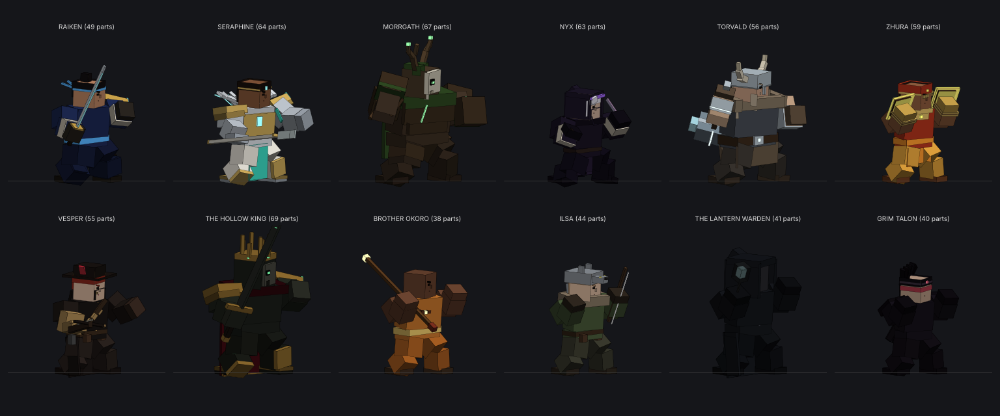

# OOF COMBAT — The Great Server Reset

A Roblox parody of modern kombat-style fighting games: "Mortal Kombat 1... but in
Roblox." Full dark, over-the-top 2.5D fighter presentation (towers, story chapter
with cinematics, supers, finishers, an announcer that will not stop yelling)
starring Roblox-meme fighters instead of ninjas and thunder gods.



*Roster and Friends rendered offline from the real rig code (`tools/rig_dump.luau`).
In Roblox they're lit, shadowed and animated.*

## The roster

| Fighter | Bit | Style |
| --- | --- | --- |
| **The Noob** | Default avatar since 2006. Possessed by storm spirits while AFK. | Katana rushdown: Ping Spike, Lag Dash, Rage Jump, AFK Parry |
| **Bacon Hair** | Saved three years for 400-Robux wings. Will stab you about it. | Spear control: Free Halo, Skewer Run, Report Button |
| **Studzilla** | 2008 kaiju built from free bricks and never anchored. | Grappler: Unanchored Hug, Brick Wave, Anchored Mode |
| **Guest 666** | The guest account that should not exist. Always behind you. | Teleport mix-ups: Behind You, Jumpscare, Spam Click |
| **Frosty** | "cool ice guy no virus" from the toolbox. Has four viruses. | Hammer zoner: Ice Cube Toss, Hammer Time, Anti-Exploit Wall |
| **Emote Queen** | Owns every dance, paid for none. Fights in choreography. | Rushdown: Hula Hoop Toss, Moonwalk Slide, Spin Emote |
| **The Camper** | Hasn't moved from her bush in six days. | Crossbow zoner: Bush Shot, Yoink Hook, Hide In Bush |
| **The Admin** *(boss)* | Bought admin for 25 Robux. Typing ;shutdown. | Power boss: ;fire all, ;speed 100, ;tp me, ;explode all |

**Friends** (call one in mid-fight): Grandpa Studs, Dog Walker Dana (and Biscuit),
The Night Guard and Pigeon Lady.

**Arenas:** Anime Dojo Simulator, The Spooky Obby Forest, Flooded Church Escape,
The Admin's Lava Throne and The Baseplate.

Finishers end with the classic Roblox break-apart: every part pops loose and
clatters across the floor with a big **OOF**.

## Play it

1. Open **`build/OofCombat.rbxlx`** in Roblox Studio (File → Open from File).
2. Press **Play** (F5) for the single-player modes (CPU fights run on your client).
   For online 1v1 and trading, use Test → Clients and Servers with 2 players (see
   *Online 1v1, trading and enchanting* below).
3. Optional: **File → Publish to Roblox** to play it on phone, tablet, console or PC.

The images (key art, emblem, stage backdrops) are already uploaded and approved on
Roblox. To hear the full soundtrack and SFX, follow the **Audio** step below.
Until then the game uses a handful of built-in Roblox sounds and is otherwise silent.

## Audio (one-time, 4 uploads + 1 optional)

The complete sound pack (≈80 SFX, footsteps and body falls, voice grunts and an "oof", 4 ambience beds and 7 music tracks)
is synthesised by `tools/synth_audio.py` and packed into four "atlas" files:

```
audio/atlas/veil_sfx.ogg        SFX + voices
audio/atlas/veil_ambience.ogg   looping ambience beds
audio/atlas/veil_music_a.ogg    menu / select / story / victory themes
audio/atlas/veil_music_b.ogg    battle themes
audio/atlas/veil_announcer.ogg  optional: your imported announcer lines
```

**Your sound pack** lives in `audio/user/` and is processed by
`python3 tools/import_user_sounds.py`. The tool trims and levels each file and splits
the announcer file on its pauses, then `tools/build_atlas.py` packs the results.

- **SFX** (in `veil_sfx.ogg`):
  - `bass_hit`: a sub-bass punch under every big hit.
  - `crack`: specials, supers and finishers.
  - `slam`: knockdowns and heavy landings.
  - `swell`: under the finisher prompt and supers.
- **Announcer** (`veil_announcer.ogg`, its own upload):
  - "Choose…": character select.
  - "Round one": first round.
  - "Fight!": fight start.
  - "Finish him": the finisher prompt, for male-voiced losers; everyone else gets
    "Delete them!".
  - "Fatality": the finisher.
  - "Flawless victory": a perfect round.
- **Heads-up:** that announcer file was made with a fish.audio voice imitating Mortal
  Kombat's announcer, and it uses MK catchphrases. Roblox moderation may reject it,
  or it may draw a takedown later. It's a separate upload for that reason. Leave
  `Assets.AudioAtlas.announcer` empty and the game uses its own announcer instead.

1. In Studio open **Window → Asset Manager → Bulk Import**, or use the Creator
   Dashboard (Development Items → Audio), and upload those four files.
2. Copy each audio asset id and paste it into `Assets.AudioAtlas` in
   `src/shared/Assets.luau` (in Studio: `ReplicatedStorage.Veil.Assets`):

```lua
Assets.AudioAtlas = {
	sfx = "1234567890",
	ambience = "1234567891",
	music_a = "1234567892",
	music_b = "1234567893",
}
```

If you uploaded the atlases before version 1.5.0, re-upload `veil_sfx.ogg`. Your
imported SFX were added to it, so its region table changed.

## VFX textures (optional, 4 uploads)

`art/vfx/` holds four original textures made by `tools/make_vfx_textures.py`:
anime speed lines, a sword-slash arc, a comic hit burst and a shockwave ring. Upload
them as images (Asset Manager → Bulk Import) and paste the ids into
`Assets.Images.FX_SpeedLines / FX_Slash / FX_HitBurst / FX_Shockwave`. Without them
the game draws speed lines and slash arcs procedurally and uses the built-in
particle textures, so nothing breaks.

Every sound then plays from its region of the atlas
(`src/shared/AudioAtlas.luau`, generated). Uploading 4 files instead of 80 keeps you
well inside Roblox's monthly audio upload limit.

## Modes

| Mode | What it is |
| --- | --- |
| **Story** | *Chapter I — The Great Server Reset.* The Admin typed ;shutdown. 9 letterboxed, subtitled scenes and 4 fights, ending with the Admin. |
| **Tower** | Seven tryhards in a row, ramping difficulty, with the Admin waiting at the top. Every fighter has a (dumb) three-card ending. |
| **Versus** | Pick your fighter, your Friend, the opponent, the server and the CPU difficulty (Noob, Pro, Tryhard, Sweat). |
| **Practice** | Infinite health and meter, a dummy that stands, blocks or fights back (switch with T / Y / the DUMMY button), and live frame data for every move. |
| **Move List** | Every special, super, finisher, string and system mechanic for the whole roster, with frame data. |
| **Settings** | Music, effects and voice volume, subtitles, camera shake, default difficulty, touch controls. Saved per player. |

## Controls

| Action | Keyboard + mouse | Gamepad | Touch |
| --- | --- | --- | --- |
| Move / crouch / jump | **A D** / **S** / **W** (or arrows, Space) | Stick / D-pad | Left thumbstick |
| Light attack | **Left click** | X | **L** |
| Heavy attack | **Right click** | Y | **H** |
| Block (hold, + S to block low) | **Q** (or Left Shift) | RB | **BLOCK** |
| Kick | **E** | A | **K** |
| Special (+ direction) | **F** | B | **SP** |
| Powers (your four specials, with cooldowns) | **1 2 3 4** | B / →B / ←B / ↓B | tap the hotbar |
| Call a Friend (+ S for variant) | **R** | LB | **FRIEND** |
| Throw (or Block + Light) | **G** | LT | **THROW** |
| Super (2 bars) / Rage Quit (in a combo) | **Z** | RT | **SUPER** |
| Dash / backdash | double-tap D / A | double-tap | double-flick the stick |
| Practice dummy mode | **T** | Y (paused) | **DUMMY** |
| Pause | **Tab** | Start / Select | **II** |
| Finisher (at *DELETE THEM*) | hold S + F | hold ↓ + B | hold ↓ + **SP** |

Menus: arrows / WASD to move, Enter or Space to confirm, Backspace or Escape to go back.
The old J K L I U O P H layout still works as an alternate.

## Online 1v1, trading and enchanting

**ONLINE** on the main menu opens a multiplayer hub for the players in your server.

- **Quick Match / Challenge a player:**
  - Each player picks a fighter, a Friend and a map. If the maps differ, the server
    flips a coin between the two picks.
  - Every fight also rolls the arena's conditions: dusk, night, fog, rain, snow, a
    lightning storm or an ash storm. No two fights on a map look the same.
- **Server-authoritative fights** (`src/server/OnlineMatch.luau`):
  - The server runs the real match with the same deterministic engine. Clients send
    only their controller state.
  - The server streams the resolved inputs (one number per player per frame) back to
    both players. Each client replays them through its own engine, so both see the
    full animated fight.
  - Periodic state checks correct any drift. Results and rewards come only from the
    server.
  - Leaving mid-fight forfeits.
- **Items:** resources (Loose Studs, Free Model Scrap, Glitch Shards, Enchant Relics,
  Admin Tokens, Oof Essence) and 25 weapon skins across the 8 fighter weapons.
  - **Enchant Altar:** spend 1 Enchant Relic + 15 Studs to roll one of 10
    enchantments: Blazing, Frostbite, Bubbly, Toxic, Stormcaller, Void, Golden,
    Glitched, Rainbow or the mythic Certified Oof.
  - **Forge:** spend Scrap + Studs for a random skin of a chosen weapon type.
  - **Cosmetic only.** Skins and enchantments change colours, materials, trails,
    particles and glow. They never touch damage, health, speed or frame data, so no
    fighter is buffed or nerfed. `tests/run` locks every fighter's combat numbers to
    a fingerprint and fails if any of them change.
- **Trading:**
  - Swap weapons (with their enchantments) and resources with another player.
  - Any change to either offer clears both READY flags. When both are ready, a
    3-second countdown runs, then the server re-checks ownership and swaps the exact
    records in one step. Both profiles save immediately.
  - Profiles are session-locked in the DataStore, so a player can't duplicate items
    by hopping servers.
- **Rarity pays (an economy buff, never a combat one):**
  - The weapon equipped on the fighter you play boosts every resource you earn from
    that fight: skin rarity (common +5% up to mythic +60%), plus its enchantment's
    rarity (+3% to +25%), plus +4% per upgrade level. The bonus caps at +150%.
  - **Upgrade** weapons up to level 10 with Studs and Scrap; Glitch Shards from level
    4, and an Admin Token from level 8. Higher levels earn more, and their
    enchantments glow and spark harder.
  - **Salvage** weapons you don't want. Rarer and more-upgraded weapons pay more,
    and mythics pay Oof Essence.
- **Rewards:**
  - Online fights pay resources, with a chance at weapons.
  - CPU fights run on your own device, so the server can't verify them. They pay a
    small, rate-limited amount (one claim per 45 s, 60 per day) and never drop
    weapons.
  - Rematches between the same two players pay out at most 4 times per hour, which
    stops win-trading.

**Testing online in Studio:** Test → Clients and Servers → 2 players → Start. Both
windows can open ONLINE and challenge or trade with each other. To keep inventories
between sessions, turn on Game Settings → Security → *Enable Studio Access to API
Services*. Without it, profiles live in memory for the session.

## Voices

Intros, victory quotes, story dialogue and the announcer ("Round 1", "Fight!") speak
their lines through Roblox's built-in text-to-speech (`AudioTextToSpeech`). Each
character has their own pitch and speed. The lines are OOF COMBAT's own originals.
If your Studio or experience doesn't offer text-to-speech, the game falls back to the
synthesized voice grunts. You can switch it off in **Settings → Voiced lines**. Voice
ids are in `src/client/Core/Voice.luau` if you want to recast anyone.

## Powers (keys 1-4)

Every fighter's four ground specials sit on a hotbar at the bottom of the screen:
press **1-4** to fire them, or use the classic motion + **F** inputs. Each power
goes on a short cooldown after use, by either input; the hotbar shows the sweep
and the seconds left, and flashes when the power is back. Projectiles recharge
fastest (1.3 s), rushes in 1.6 s, teleports in 2 s, and parries and invincible
reversals in 2.3-2.5 s. The CPU plays by the same cooldowns. Practice mode has
none. Tune them in `Config.PowerCooldown`, or per move with a `cooldown` field.

## Combat system

- **60 Hz deterministic engine** (`src/shared/Combat/Engine.luau`). Every move has
  real startup, active and recovery frames, on-hit and on-block advantage, and
  hitboxes against standing, crouching and airborne hurtboxes.
- **Guard levels:** highs whiff on crouchers, lows must be blocked crouching,
  overheads must be blocked standing, and throws beat block.
- Target-combo **strings**, **special cancels**, launchers and **juggles** with
  gravity scaling, combo damage scaling, hitstop, pushback and corner pushback.
- **Specials:** projectiles (including boomerang, ground-travel, stationary and
  absorbing), teleports, command grabs, parries, armor, dive kicks and multi-hit
  flurries.
- **Friends** (internally "Echoes"): each fighter brings an ally with a neutral and
  a down variant on a cooldown, usable mid-combo. Your Friend leaves if you get hit
  before they strike.
- **Rage meter (3 bars):** a 2-bar cinematic **Super** that's invulnerable on
  startup, or a 1-bar **Rage Quit** to burst out of a combo.
- **Throw escapes**, dashes and backdashes, wake-up invulnerability, chip damage
  that can't KO, time-out decisions and sudden death.
- **Finishers:** win the final round, then hold down + Special during *DELETE THEM*
  for your fighter's finisher cinematic (Factory Reset, Extra Crispy, ;kill...). It
  ends with the classic Roblox break-apart and an OOF instead of gore.

## Presentation

- **Animation:** authored poses are time-mapped onto each move's real frame data,
  crossfaded between states, and then run through a spring layer
  (`Render/AnimSpring.luau`) on the hips, spine, head and arms. That gives weight,
  overshoot and follow-through without hiding the active frames: arms stiffen around
  them. Hits kick the victim's spine and head by height and strength (heads snap back
  on highs, bodies fold on mids, hips drop on lows). Landings squash and dashes lean.
  Legs stay on exact IK, so feet don't slide. The walk carries weight transfer and
  torso counter-twist, with footsteps (and dust for the heavyweights).
- **Personality:** every fighter idles differently (the Noob bounces, Studzilla and
  Frosty breathe heavy, Guest 666 stands still and twitches, Emote Queen can't stop
  dancing, the Camper scans, the Admin is smug) and has a signature victory pose.
- **Impact:** effects scale with hit strength, so light hits stay small and heavies
  bring streaks, rings and a flash of light on the set. Sparks fly the way the blow
  travelled. The camera jolts in the direction of the hit (upward on launchers) and
  punches in on big ones. Heavies get a layered sub-thump, and knockdowns a body fall.
- **Battlegrounds-style impacts** (`Render/Impacts.luau`):
  - Craters of rock chunks punch open under knockdowns from big hits and under
    heavy landings.
  - Debris flies on bezier arcs and lands.
  - Glass afterimages trail dashes, teleports and super flurries.
  - Anime impact lines burst from big hits, and lightning-element hits throw forked
    lightning.
  - Supers and finishers end in a force-field dome.
  - Pieces come from a pool and are capped, so spam can't tank the frame rate.
  - These follow common community techniques (raycast craters, bezier debris,
    glass-clone afterimages); the code is original.
- **Rarity auras:** epic skins (or level 8+) give the fighter rising motes. Legendary
  adds a glow haze and light, mythic adds embers and a pulsing light, and max-level
  weapons add a sparkle crown.
- **Arenas** (`Render/StageLife.luau`): key and rim lights follow each fighter, and
  light shafts come through the trees and church windows. Each stage has a background
  crowd of classic blocky players with bubble chat who react to heavy hits and KOs.
  Stage events: obby players hopping on bobbing platforms, simulator grinders punching
  logs for +1 STRENGTH, players stranded on the church balcony during lightning
  storms, banned players caged behind the lava throne during eruptions. The colour
  grade pulses on heavy hits and drains on a KO.
- **Story cutscenes** (`Render/Cutscene.luau` + `Render/CineFX.luau`), edited like a
  Roblox animation channel:
  - Characters act. They nod and gesture while talking: a shrug on questions, a
    shout on CAPS, a point on "!", a wave on "hey". Listeners turn to face the
    speaker. Characters also walk into frame, hop, and throw attacks.
  - Dialogue is covered automatically with two-shots, over-the-shoulder angles and
    close-ups, and shouted lines get a crash zoom.
  - Editing beats: freeze-frame name cards with a record scratch, impact frames
    (stark black/white flashes), pop captions, speed lines, slow motion, whip pans
    with motion blur, and a "TO BE CONTINUED" freeze to close the chapter.
  - Supers and finishers in fights use the same speed lines and impact frames.
  - **Settings → Screen flashes** swaps the strobing for a gentle version.
- **Cinematics:** letterboxed intros with lower-third name cards, and letterboxing for
  supers, finishers and victories. The gameplay HUD slides away while the bars are in.
  P1 / CPU markers float over the fighters at FIGHT, and screens change with a
  diagonal wipe.

## The CPU

`src/shared/Combat/AI.luau` drives the same input table a player does. It sees the
fight through a reaction delay and rolls difficulty-scaled chances to block (and
read high, low or overhead), punish unsafe moves, anti-air, tech throws, break
combos and use parry stances. It runs authored per-fighter combo routes, zones
with projectiles, keeps each archetype's preferred range, and calls Friends and
Supers.

## Project layout

```
default.project.json         Rojo project (Lighting = Future, no auto characters)
build/OofCombat.rbxlx        ready-to-open place file
src/shared/                  ReplicatedStorage.Veil
  Config, Assets, AudioAtlas
  Data/   Fighters, Echoes, Stages, Story, MoveKit
  Combat/ Engine, AI, Rng
src/client/                  StarterPlayerScripts.VeilClient
  Main.client                game flow
  Core/   Input, Audio
  Render/ RigMath (FK + leg IK), Poses (60+ animations), AnimSpring, Looks, Rig,
          StageBuilder, StageLife, VFX, FightCamera, FightView, Cutscene, CineFX
  UI/     Theme, Screens, HUD, Portrait, Subtitles, MobileControls
src/server/                  ServerScriptService.VeilServer
  Main.server                remotes, validation, rate limits
  Profiles                   DataStore profiles with session locking (v1 saves migrate)
  Inventory                  resources, weapon skins, enchant altar, forge, rewards
  Trading                    trade state machine + atomic swap
  OnlineMatch                queue, challenges, server-run fights, input relay
tests/                       Lune test-suites + headless Roblox runtime mock
tools/                       audio synth, atlas packer, VFX texture maker, pose / rig / UI previews
art/vfx/                     optional VFX textures to upload
audio/atlas/                 the four audio files to upload
```

## Building and testing

The tools are [Rojo](https://rojo.space) 7, [Lune](https://lune-org.github.io/docs)
0.11 and [Selene](https://github.com/Kampfkarren/selene).

```sh
rojo build -o build/OofCombat.rbxlx   # place file
lune run tests/run                       # engine + AI: every input, 128 CPU matches, determinism
lune run tests/server                    # inventory, trading (dupe checks), online matches + replay
lune run tests/client_smoke              # whole client in a mock Roblox runtime
selene src                               # lint (custom std: veil.yml)
python3 tools/synth_audio.py && python3 tools/import_user_sounds.py && python3 tools/build_atlas.py   # regenerate audio
```

`tests/client_smoke` loads the real client modules inside a headless Roblox
runtime. Instances come from `@lune/roblox`, so every property name, type and enum
is checked against Roblox's API. It then:

- builds every stage, rig and projectile;
- plays four full CPU matches through the renderer, HUD, VFX, supers and finishers;
- drives every menu screen and every story cutscene;
- walks the real game flow: title → Practice → pause → quit → Versus → results.

It fails on any error raised in any handler.

## Previews

`tools/rig_preview.py` and `tools/ui_preview.py` render offline previews from the
real code: `docs/attacks_preview.png` shows heavy-attack poses,
`docs/hud_layout.png` / `docs/hud_touch_layout.png` show the HUD layout for desktop
and touch, and `docs/intro_layout.png` shows the letterboxed intro with its name card. These are layout mock-ups, not in-engine screenshots.

## Asset credits

- Key art, logo emblem and three stage backdrops: generated with ForgeGUI for this
  project and published to Roblox.
- Characters, weapons, armor, stages and effects: built procedurally from Roblox
  parts, materials and built-in particle textures.
- Music, SFX, voices, the oof and ambience: procedurally synthesised by
  `tools/synth_audio.py`.
